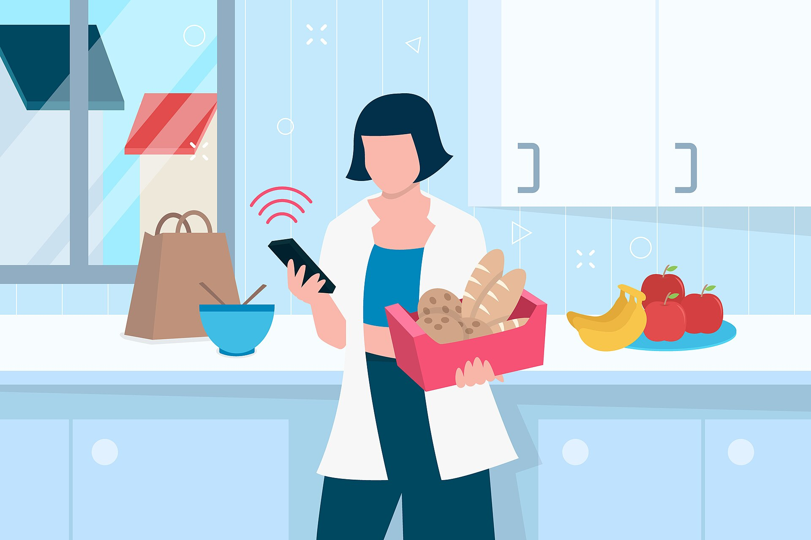

אפליקציות המשלוחים הפכו בשנים האחרונות לחלק בלתי נפרד מההרגלים הצרכניים של הישראלים — אך הנוחות של הזמנת ארוחה בלחיצת כפתור גובה מחיר גבוה בהרבה ממה שנדמה. בין דמי משלוח, דמי שירות, תוספת שירות למסעדה ותפריט שמחיריו מנופחים מראש, הזמנה טיפוסית דרך **וולט** או **תן ביס** עשויה להתייקר בעשרות אחוזים לעומת איסוף עצמי ישיר מהמסעדה.

## כמה באמת עולה לנו המשלוח?

כשאנחנו מזמינים אוכל באפליקציות משלוחים, המחיר הסופי מורכב ממספר שכבות שלא תמיד שקופות לצרכן. השכבה הראשונה היא **דמי המשלוח** עצמם — סכום שנע לרוב בין כמה שקלים לעשרות שקלים, בהתאם למרחק, לשעה ולעומס. השכבה השנייה היא **דמי שירות** שהאפליקציה גובה על כל הזמנה, לעיתים כאחוז מסכום העסקה.

אך השכבה המשמעותית ביותר נסתרת מהעין: **העמלה שהאפליקציה גובה מבתי העסק**. מסעדות משלמות לפלטפורמות המשלוחים עמלה של כ-20%-35% מכל הזמנה. כדי לשמור על רווחיות, חלק ניכר מהמסעדות פשוט מעלות את מחירי התפריט באפליקציה — כך שמנה שעולה סכום מסוים בישיבה במקום, מתומחרת גבוה יותר במסך הסמארטפון.

## מדוע המחיר באפליקציה גבוה ממחיר המסעדה?

זוהי אחת התופעות הפחות מוכרות לצרכן: **מחיר כפול**. מסעדות רבות מנהלות שני תפריטים — אחד למי שאוכל במקום, ואחד, יקר יותר, למזמינים דרך אפליקציות המשלוחים. ההפרש נע לרוב בין 10% ל-20%, ולעיתים יותר. המטרה היא לקזז את העמלה שהפלטפורמה גובה, מבלי לפגוע ברווחיות ההזמנות הישירות.

כשמחברים את כל הרכיבים יחד — מחיר תפריט מנופח, דמי משלוח ודמי שירות — מגיעים למצב שבו הזמנה שעלותה במסעדה הייתה סכום מסוים, מתייקרת ב-30% ואף ב-50% בהזמנה דרך האפליקציה.

## השוואת עלויות: הזמנה דרך אפליקציה מול איסוף עצמי

הטבלה הבאה ממחישה את ההבדל העקרוני בין האפיקים השונים (הנתונים להמחשה, והפערים משתנים בין מסעדות ואזורים):

| אפיק הזמנה | מחיר התפריט | דמי משלוח/שירות | התייקרות כוללת |
|---|---|---|---|
| אכילה במסעדה | מחיר בסיס | אין | 0% |
| איסוף עצמי | מחיר בסיס או קרוב אליו | אין | 0%-5% |
| אפליקציית משלוחים | גבוה ב-10%-20% | דמי משלוח + דמי שירות | כ-30%-50% |
| מנוי משלוחים חינם | גבוה ב-10%-20% | ללא דמי משלוח, בתשלום חודשי | תלוי בתדירות |

## האם מנויי המשלוחים משתלמים?

גם וולט וגם תן ביס מציעות מנויים חודשיים שמבטיחים **משלוחים ללא דמי משלוח** בתמורה לתשלום קבוע. עבור צרכן שמזמין מספר פעמים בשבוע, מנוי כזה עשוי בהחלט להשתלם ולחסוך עשרות שקלים בחודש. אולם חשוב לזכור שהמנוי מבטל רק את דמי המשלוח — הוא אינו מוזיל את מחירי התפריט המנופחים ואינו מבטל בהכרח את דמי השירות.

למזמין מזדמן, שמשתמש בשירות פעם-פעמיים בחודש, המנוי לרוב אינו כדאי. במקרים אלה שווה לעצור ולחשב: האם החיסכון בדמי המשלוח מצדיק את התשלום החודשי הקבוע.

### טיפים צרכניים לחיסכון

- **בדקו איסוף עצמי**: רבות מהאפליקציות מאפשרות הזמנה עם איסוף מהמסעדה, שמבטלת את דמי המשלוח ולעיתים גם מוזילה את מחיר התפריט.
- **השוו למחיר הישיר**: לפני הזמנה, שווה לבדוק את מחיר המנה באתר המסעדה או בטלפון — ההפרש עשוי להפתיע.
- **שימו לב למינימום הזמנה**: רף ההזמנה המינימלי דוחף לעיתים להוספת פריטים מיותרים.
- **הצטברות עלויות**: סכמו את כל הרכיבים לפני אישור ההזמנה, ולא רק את מחיר המנות.

## שוק צומח — ורגולציה שמתעוררת

שוק המשלוחים בישראל צמח בקצב מהיר מאז מגפת הקורונה, והפך לזירה תחרותית שבה וולט ותן ביס נאבקות על נתח השוק. ככל שהשוק מתבגר, גובר העניין הציבורי והרגולטורי בשאלת השקיפות — בעיקר סביב תופעת המחיר הכפול ושיעור העמלות שמשיתות הפלטפורמות על בתי העסק הקטנים.

בשורה התחתונה: אפליקציות המשלוחים מספקות נוחות אמיתית, אך הצרכן הישראלי משלם עליה פרמיה משמעותית. מודעות לרכיבי העלות השונים — ובעיקר לפער בין מחיר האפליקציה למחיר הישיר — יכולה לחסוך מאות שקלים בשנה.
