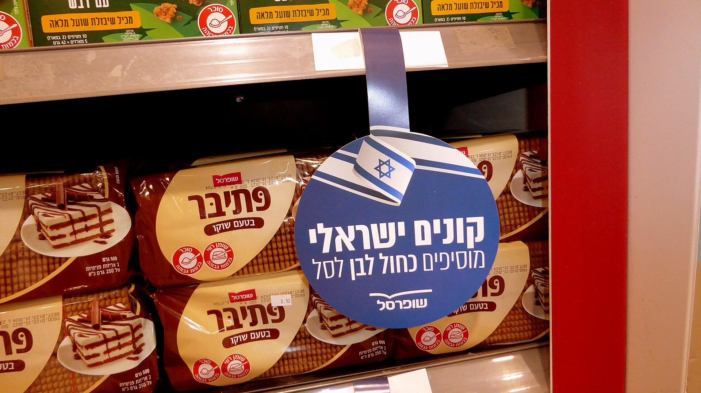

בעידן של יוקר מחיה מתמשך, **המותג הפרטי** הפך לאחד הכלים המרכזיים של הצרכן הישראלי לצמצום ההוצאה על סל הקניות. מדובר במוצרים שמשווקים תחת המותג של רשת השיווק עצמה — ולא תחת שם של יצרן מוכר — ומחירם נמוך בדרך כלל ב-20% עד 40% ממוצר מותג מקביל. המגמה, שהחלה כפתרון לחסכנים, הפכה בשנים האחרונות לזרם מרכזי שמשנה את מפת המדפים.

## מהו מותג פרטי ולמה הוא זול יותר?

מותג פרטי הוא מוצר שרשת השיווק מזמינה מיצרן, אורזת תחת שמה המסחרי ומוכרת ישירות לצרכן. המחיר הנמוך נובע מכמה גורמים: חיסכון בהוצאות פרסום ושיווק אדירות שמשוקעות במותגי היצרן הגדולים, מו"מ ישיר מול יצרנים, והיעדר שרשרת מתווכים. במקרים רבים אותו קו ייצור שמייצר מותג מוביל מייצר גם את המוצר הפרטי — כך שהפער באיכות קטן בהרבה מהפער במחיר.

ברשתות כמו **שופרסל**, **רמי לוי**, **יינות ביתן** ו**ויקטורי** הורחב בשנים האחרונות מגוון המוצרים הפרטיים — מחלב, קמח ושמן ועד מוצרי ניקיון, חטיפים ומוצרי טיפוח. חלק מהרשתות אף פיתחו מותגי "פרימיום" פרטיים שמתחרים ישירות במוצרי היוקרה.

## כמה באמת חוסכים? השוואת מחירים

החיסכון משתנה לפי קטגוריית המוצר, אך ברוב המקרים מדובר בפער משמעותי. הנה השוואה כללית הממחישה את סדרי הגודל (הנתונים מייצגים טווחי מחירים ממוצעים ולא מחיר מדויק בנקודת זמן):

| קטגוריית מוצר | מותג יצרן (טווח) | מותג פרטי (טווח) | חיסכון מוערך |
|---|---|---|---|
| חלב 3% ליטר | כ-6-7 ₪ | כ-5-6 ₪ | ~15% |
| קורנפלקס 500 גרם | כ-18-22 ₪ | כ-10-13 ₪ | ~35% |
| נייר טואלט (מארז) | כ-30-40 ₪ | כ-18-25 ₪ | ~35% |
| שמן זית 750 מ"ל | כ-40-55 ₪ | כ-28-38 ₪ | ~30% |
| חטיפי שוקולד | כ-6-8 ₪ | כ-3-5 ₪ | ~40% |

ההבדל המצטבר בסל קניות חודשי טיפוסי יכול להגיע למאות שקלים בשנה — סכום לא מבוטל עבור משק בית ממוצע.

## מדוע המגמה מתחזקת דווקא עכשיו?

גל ההתייקרויות שפקד את מחירי המזון בישראל, לצד הלחץ הציבורי סביב יוקר המחיה, דחף צרכנים רבים לבחון מחדש את הרגלי הקנייה שלהם. כשמותג מוביל מייקר את מחירו, הצרכן מגלה שהחלופה הפרטית מציעה חוויית צריכה דומה במחיר נמוך בהרבה. 

גם הרשתות עצמן מרוויחות: שולי הרווח על מותג פרטי גבוהים יותר בדרך כלל מאשר על מותג יצרן, והמוצר יוצר נאמנות לרשת — הצרכן שרוצה את אותו מוצר יחזור לאותה חנות. לכן אנו רואים השקעה גוברת של הרשתות בעיצוב אריזות, בשיפור איכות ובהרחבת הסדרות.

### האם זה פוגע ביצרנים הגדולים?

התשובה מורכבת. חברות מזון גדולות חשות את הלחץ, וחלקן מגיבות במבצעים אגרסיביים או בהשקת סדרות מוזלות משלהן. מנגד, חלק מהיצרנים הם אלו שמייצרים את המותג הפרטי עבור הרשתות — כך שהם נהנים משני העולמות. בטווח הארוך, הצמיחה של המותג הפרטי מגבירה את התחרות ועשויה למתן את עליות המחירים בכלל הקטגוריה.

## איך לקנות נכון? טיפים לצרכן

- **השוו רכיבים, לא רק מחיר** — בדקו את רשימת הרכיבים והערכים התזונתיים. לעיתים המוצרים כמעט זהים.
- **התחילו מקטגוריות בטוחות** — מוצרי יסוד כמו קמח, סוכר, נייר טואלט ומוצרי ניקיון הם נקודת פתיחה מצוינת לחיסכון עם סיכון נמוך.
- **אל תוותרו על מה שחשוב לכם** — אם אתם מעדיפים מותג מסוים של קפה או שוקולד, שלבו. אין צורך בגישת הכול או כלום.
- **עקבו אחר מבצעים** — לעיתים מותג יצרן במבצע זול יותר מהמוצר הפרטי. השוואה נקודתית חשובה.

## שורה תחתונה

המותג הפרטי כבר אינו "החלופה הזולה והנחותה" של פעם, אלא שחקן מרכזי ולגיטימי במדף הישראלי. עבור הצרכן, מדובר בכלי יעיל לצמצום ההוצאה החודשית — בתנאי שמשלבים אותו בחוכמה עם מותגי היצרן האהובים. ככל שהתחרות בין הרשתות תתחזק, סביר שנראה מגוון רחב יותר ואיכות גבוהה יותר, מה שישרת בסופו של דבר את כיס הצרכן.
