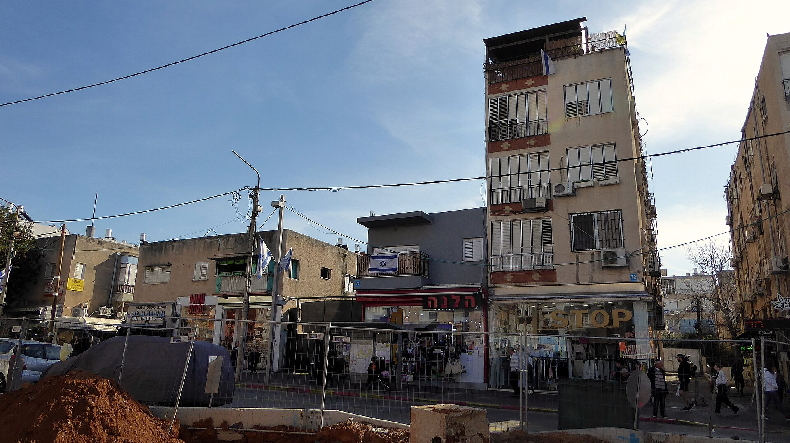

מלאי הדירות הלא-מכורות בישראל נמצא ברמת שיא היסטורית — עשרות אלפי דירות חדשות שהקבלנים בנו או מבנים, אך טרם מצאו קונה. זהו אחד הסימנים הבולטים לקיפאון שאחז בשוק הנדל"ן בשנה החולפת, תוצאה ישירה של ריבית גבוהה, משכנתאות יקרות ורוכשים שבוחרים להמתין בצד. השאלה הגדולה: האם ערֵמת הדירות הזו תוביל סוף-סוף לירידת מחירים?

## למה נערם מלאי הדירות הלא-מכורות?

הגורם המרכזי הוא עלות הכסף. לאחר שבנק ישראל העלה את הריבית במהירות, ההחזר החודשי על משכנתה ממוצעת התייקר במאות עד אלפי שקלים. רוכשים פוטנציאליים רבים גילו שהם פשוט אינם יכולים לעמוד בהחזרים, או שהם מעדיפים להמתין עד שתתבהר מגמת הריבית.

במקביל, הביקושים ירדו גם מסיבות פסיכולוגיות: חוסר ודאות כלכלי וביטחוני, ציפייה לירידת מחירים, וחשש מרכישה ברמות שיא. התוצאה — פער הולך וגדל בין קצב סיום הבנייה לבין קצב המכירות בפועל.

### היכן המלאי מתרכז?

המלאי אינו מתפזר באופן אחיד. באזורי הביקוש המרכזיים, המחירים נותרו עמידים יחסית, בעוד שבפריפריה ובפרויקטים גדולים חדשים מצטברות הדירות הלא-מכורות במהירות. גם דירות יוקרה וגדולות במיוחד מתקשות למצוא קונים.

## איך מגיבים הקבלנים?

במקום להוריד את מחיר המחירון — מהלך שעלול לפגוע בשווי הפרויקט כולו ובביטחונות מול הבנקים — הקבלנים נוקטים בטקטיקות מימון יצירתיות:

- **מבצעי 20-80 ודומיהם**: תשלום מקדמה נמוך בחתימה והיתרה במסירה, מהלך שבנק ישראל כבר מהדק עליו את הפיקוח.
- **הטבות נלוות**: ריהוט, מחסן, חניה או שדרוגים ללא תוספת מחיר.
- **ערבות מחיר** והנחות למשלמים במזומן.
- **סבסוד ריבית** על המשכנתה לתקופה הראשונה.

בפועל, מדובר בהוזלה עקיפה — המחיר הנקוב נשאר גבוה, אך העלות האמיתית לרוכש יורדת.

## השוואה: מה השתנה בשוק הדירות החדשות

| פרמטר | תקופת הגאות | המצב כיום |
|---|---|---|
| ריבית בנק ישראל | נמוכה מאוד | גבוהה יחסית |
| קצב מכירות דירות חדשות | מהיר | איטי |
| מלאי דירות לא-מכורות | נמוך | שיא היסטורי |
| מבצעי מימון של קבלנים | מעטים | נפוצים מאוד |
| כוח המיקוח של הרוכש | נמוך | גבוה |

## האם צפויה ירידת מחירים?

זו שאלת מיליון השקלים. מצד אחד, מלאי עצום לוחץ על הקבלנים: ככל שדירה עומדת ריקה זמן רב יותר, כך גדל הלחץ התזרימי, במיוחד על חברות יזמיות ממונפות. חלקן עלולות להיאלץ למכור בהוזלה אמיתית כדי לשחרר מזומנים.

מצד שני, גורמים מבניים ממשיכים לתמוך במחירים: מחסור כרוני בפועלי בניין שמייקר את עלויות הבנייה, קצב התחלות בנייה שירד, וגידול טבעי באוכלוסייה שמזין ביקוש מצטבר. כאשר הריבית תתחיל לרדת, חלק מהרוכשים הממתינים צפויים לחזור לשוק בבת אחת — מה שעלול דווקא להצית מחדש את המחירים.

### מה כדאי לרוכש לעשות?

דווקא בתקופה של מלאי גבוה, כוח המיקוח של הרוכשים חזק מתמיד. שווה להשוות בין פרויקטים, לבקש הטבות, ולבדוק בקפידה את ההבדל בין מחיר המחירון לעלות הכוללת בפועל. עם זאת, חשוב לזכור כי מבצעי מימון אגרסיביים טומנים לעיתים סיכון — כדאי לבחון את יציבות החברה היזמית ואת תנאי המימון לעומק.

## שורה תחתונה

מלאי הדירות הלא-מכורות הוא מדד בריאות מרכזי לשוק הנדל"ן הישראלי, והוא משקף כעת קיפאון עמוק. הירידה במחירים אינה ודאית — אך לראשונה מזה שנים, המאזן בין קבלן לרוכש השתנה לטובת הקונה. התפנית האמיתית תלויה בעיקר במהלכי הריבית של בנק ישראל בחודשים הקרובים.
