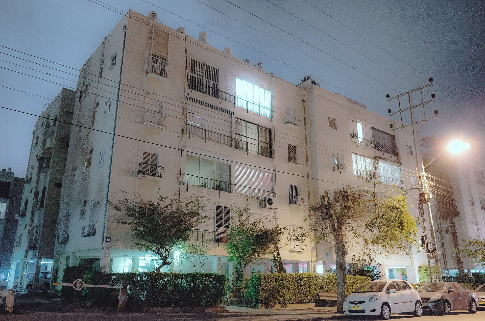

## מדוע שכר הדירה בישראל ממשיך לטפס?

**שכר הדירה בישראל** רושם בשנה החולפת עליות חדות, בעיקר באזורי הביקוש במרכז הארץ, על רקע שילוב של ביקוש גואה, היצע מוגבל וריבית גבוהה שמרחיקה רוכשים פוטנציאליים משוק הדיור הנרכש. התוצאה: שוכרים רבים מגלים כי חוזה השכירות המתחדש מגיע עם עלייה של מאות שקלים בחודש, ולעיתים אף יותר.

המגמה אינה חדשה, אך היא התעצמה בשנתיים האחרונות. כאשר הריבית של בנק ישראל נותרה גבוהה לאורך זמן, ההחזר החודשי על משכנתה חדשה התייקר דרמטית. משקי בית צעירים רבים, שתכננו לרכוש דירה ראשונה, נאלצו לדחות את הרכישה ולהישאר בשוק השכירות — מה שהגדיל את הביקוש לדירות להשכרה והפעיל לחץ כלפי מעלה על המחירים.

## אילו אזורים מובילים את עליות השכירות?

אזור תל אביב וגוש דן ממשיכים להוביל את הטבלה, כשמחירי השכירות בהם נמצאים בשיא היסטורי. אך התופעה מתפשטת גם אל ערים שנחשבו בעבר לזולות יותר — כמו ערי השרון, אזור השפלה וערי הלוויין סביב המטרופולינים. העלייה במחירי הדיור הנרכש והמעבר של משפחות אל הפריפריה הקרובה
