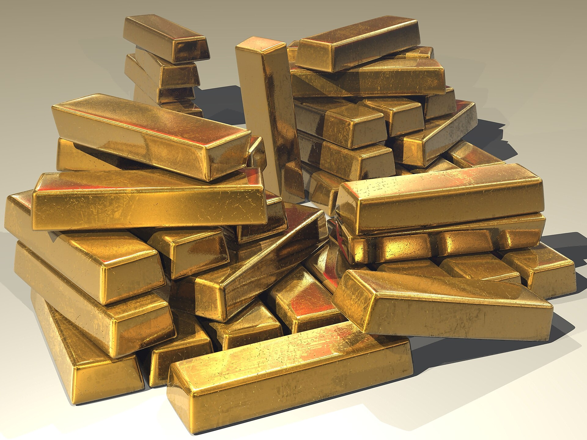

**מחיר הזהב** שבר בשנה החולפת שיאים היסטוריים וריתק אליו את תשומת לבם של משקיעים ברחבי העולם — ובהם ישראלים רבים שמחפשים מקלט מפני אי-ודאות ואינפלציה. התשובה הקצרה לשאלה מדוע הזהב מזנק: שילוב של מתחים גיאופוליטיים, ציפיות להורדות ריבית בארצות הברית ורכישות אגרסיביות של בנקים מרכזיים, שהפכו את המתכת הצהובה לנכס המבוקש של התקופה.

אך מאחורי הראלי המרשים מסתתרת גם שאלה מהותית: האם מי שקונה זהב כעת מצטרף למגמה בריאה — או קופץ על קרון שכבר דהר רחוק מדי?

## למה מחיר הזהב מזנק דווקא עכשיו?

הזהב נחשב מזה דורות ל"נכס מקלט" — נכס שאליו נוהרים משקיעים כשהחשש גובר. בתקופה האחרונה הצטברו כמה כוחות שדחפו את המחיר כלפי מעלה בו-זמנית:

- **אי-ודאות גיאופוליטית:** מלחמות, מתחים בין מעצמות וחוסר יציבות פוליטי מגבירים את הביקוש לנכס שאינו תלוי בממשלה או בבנק מסוים.
- **ציפיות להורדות ריבית:** כאשר הריבית יורדת, התשואה על אג"ח ופיקדונות נשחקת, והזהב — שאינו נושא ריבית — הופך אטרקטיבי יחסית.
- **רכישות בנקים מרכזיים:** בנקים מרכזיים במדינות רבות הגדילו משמעותית את רכישות הזהב שלהם כחלק מגיוון היתרות והפחתת התלות בדולר.
- **חשש מאינפלציה:** הזהב נתפס כשומר ערך לאורך זמן מול שחיקת כוח הקנייה של המטבעות.

## כיצד משקיע ישראלי יכול להיחשף לזהב?

בניגוד לעבר, כיום אין צורך לרכוש מטילים פיזיים ולאחסן אותם בכספת. למשקיע הישראלי פתוחות כמה דרכים, לכל אחת יתרונות וחסרונות:

| אפיק השקעה | נזילות | עלויות | מורכבות |
|---|---|---|---|
| קרנות סל (ETF) עוקבות זהב | גבוהה | נמוכות-בינוניות | נמוכה |
| מניות חברות כריית זהב | גבוהה | דמי ניהול/עמלות | בינונית-גבוהה |
| זהב פיזי (מטילים ומטבעות) | נמוכה | אחסון וביטוח | בינונית |
| חוזים עתידיים | גבוהה | מינוף וסיכון | גבוהה |

האפיק הנפוץ והנוח ביותר עבור הציבור הרחב הוא **קרנות הסל העוקבות אחר מחיר הזהב**, הנסחרות בקלות דרך חשבון הבנק או בית ההשקעות, בדומה לרכישת מניה. כך נחסכים הטרחה והעלויות הכרוכות באחזקת זהב פיזי.

### מה המשמעות של שער הדולר-שקל?

חשוב לזכור שמחיר הזהב נקוב בדולרים. לכן, עבור המשקיע הישראלי, התשואה בפועל מושפעת גם מתנודות **שער הדולר-שקל**. התחזקות השקל מול הדולר עלולה לכרסם ברווח מעליית מחיר הזהב, ולהפך — פיחות בשקל עשוי להגדיל את התשואה השקלית.

## האם עדיין כדאי להיכנס לזהב?

זו שאלת מיליון הדולר, ואין עליה תשובה חד-משמעית. מצד אחד, הכוחות שדחפו את המחיר למעלה — אי-ודאות גלובלית ומגמת הורדות הריבית — עדיין נוכחים. מצד שני, לאחר ראלי כה חד, הסיכון לתיקון מחירים חד גובר.

החיסרון המובנה של הזהב הוא שהוא **אינו מניב תזרים** — אין דיבידנד ואין ריבית. כל התשואה נשענת על ההנחה שמישהו ישלם עליו יותר בעתיד. זאת בניגוד למניות דיבידנד או לנדל"ן מניב, שמייצרים הכנסה שוטפת.

רוב מנהלי ההשקעות ממליצים להתייחס לזהב כאל **רכיב ביטוחי** בתיק ולא כמנוע תשואה מרכזי. חשיפה של אחוזים בודדים מסך התיק יכולה לשמש כריית ביטחון בעיתות משבר, מבלי לחשוף את המשקיע לתנודתיות הגבוהה של ריכוז יתר בנכס יחיד.

## שורה תחתונה

הראלי במחיר הזהב משקף את רוח התקופה — חיפוש אחר יציבות בעולם רווי אי-ודאות. עבור המשקיע הישראלי, קרנות הסל מציעות דרך פשוטה ונזילה להיחשף למתכת היקרה. עם זאת, כניסה לאחר זינוק חד מחייבת זהירות, פיזור נבון ותיאום ציפיות: הזהב הוא ביטוח לתיק, לא קיצור דרך לעושר.
