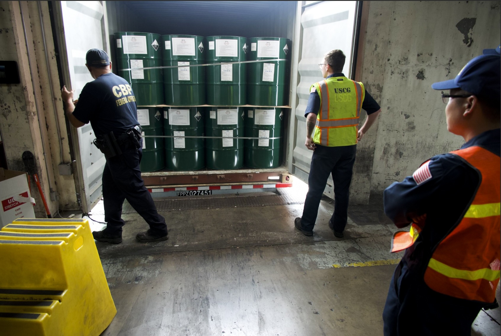

ההרגל הצרכני הישראלי שהתבסס בשנים האחרונות — הזמנת מוצרים זולים ישירות מחו"ל דרך פלטפורמות כמו עלי אקספרס, טמו ושיין — עומד בפני שינוי אפשרי. **קניות מחו"ל** נהנות כיום מפטור ממכס וממע"מ על חבילות בשווי של עד 75 דולר, אך לחצים מצד הקמעונאות המקומית ומשרד האוצר עשויים להוביל להורדת הסף הזה או לביטולו — מהלך שישפיע ישירות על הכיס של מיליוני צרכנים.

## מהו הפטור הקיים על קניות מחו"ל?

נכון להיום, יבוא אישי של מוצרים בשווי של עד 75 דולר פטור ממכס וממע"מ. בטווח שבין 75 ל-500 דולר חלים מע"מ ובמקרים מסוימים גם מכס, ומעל 500 דולר מתווספות חבויות נוספות. המנגנון הזה הוא שהפך את ההזמנות מחו"ל לכדאיות במיוחד: חולצה, אביזר לטלפון או גאדג'ט ביתי שמחירם כמה עשרות שקלים מגיעים עד הבית ללא תוספות מס.

התוצאה היא גל עצום של חבילות קטנות שנכנסות לישראל מדי חודש, רובן המכריע מסין. פלטפורמות כמו **טמו** ו**שיין** בנו את המודל העסקי שלהן בדיוק סביב נקודת המחיר הזו — מוצרים זולים מאוד, לרוב מתחת לסף הפטור.

## מדוע הפטור עומד לשינוי?

הביקורת על הפטור מגיעה משני כיוונים עיקריים. ראשית, הקמעונאים והיצרנים המקומיים טוענים לתחרות לא הוגנת: עסק ישראלי משלם מע"מ מלא, מכס ועלויות רגולציה, בעוד שחבילה זהה מחו"ל מגיעה פטורה. שנית, משרד האוצר רואה בפטור מקור להכנסות אבודות, במיוחד על רקע הגירעון התקציבי והצורך בהגדלת הכנסות המדינה.

גם שיקולי פיקוח ובטיחות מוצרים עולים לדיון — חלק גדול מהמוצרים הזולים אינם עוברים בדיקות תקינה ישראליות. הורדת סף הפטור, כך נטען, תאלץ יותר יבוא לעבור דרך ערוצים מפוקחים.

### מה אומרים המתנגדים לשינוי?

מנגד, ארגוני צרכנים מזהירים כי הורדת הפטור תפגע בעיקר במשקי בית בעלי הכנסה נמוכה-בינונית, שעבורם ההזמנות הזולות מחו"ל הפכו לחלק מתקציב משק הבית. הם מצביעים על כך שהתחרות מחו"ל דווקא מרסנת את יוקר המחיה המקומי הגבוה.

## כמה זה יעלה לכם? השוואת תרחישים

נניח הזמנה של מוצר בשווי 60 דולר (כ-220 שקל). כך עשוי להשתנות המחיר הסופי בתרחישים שונים של מדיניות:

| תרחיש | מע"מ (18%) | עמלת טיפול משוערת | תוספת לצרכן |
|---|---|---|---|
| פטור מלא (המצב כיום) | 0 ₪ | 0 ₪ | 0 ₪ |
| ביטול הפטור והחלת מע"מ | כ-40 ₪ | כ-10-30 ₪ | כ-50-70 ₪ |
| הורדת סף הפטור ל-25 דולר | כ-40 ₪ | כ-10-30 ₪ | כ-50-70 ₪ |

*הנתונים להמחשה בלבד ומבוססים על הערכות; שיעורי המכס והעמלות בפועל תלויים בסוג המוצר ובמדיניות שתיקבע.*

ההמחשה מבהירה את העיקר: על מוצר זול, תוספת של מע"מ ועמלות טיפול יכולה לייקר את ההזמנה בעשרות אחוזים ולפגוע בכדאיות שהניעה את כל התופעה מלכתחילה.

## איך זה משתלב במגמות הצרכנות בישראל?

המהלך האפשרי מגיע על רקע מאבק רחב יותר על יוקר המחיה. הצרכן הישראלי, שהתרגל להשוות מחירים בלחיצת כפתור, הפך את הרכישה הישירה מחו"ל לכלי לחץ על השוק המקומי. בה בעת, רשתות קמעונאיות מקומיות וחברות כמו הפלטפורמות הישראליות מנסות להתחרות במחיר ובזמני אספקה.

אם וכאשר ייכנס שינוי לתוקף, סביר שנראה התאמות גם מצד הפלטפורמות הזרות — חלקן עשויות לפתוח מחסנים מקומיים או להציג מחירים כוללי-מס כדי לשמר את נתח השוק הישראלי.

## מה כדאי לצרכן לעשות עכשיו?

- **עקבו אחר שווי ההזמנה**: שימו לב לסף של 75 דולר ולשינויים עתידיים אפשריים.
- **השוו מחיר סופי, לא מחיר מוצג**: הביאו בחשבון דמי משלוח, עמלות וזמני אספקה.
- **שקלו ריכוז הזמנות**: לעיתים פיצול או איחוד חבילות משפיעים על חבות המס.
- **בדקו תקינות ואחריות**: מוצרים זולים מחו"ל לא תמיד נהנים משירות ואחריות מקומיים.

בשורה התחתונה, עידן הזהב של הקניות הזולות מחו"ל אינו בהכרח מגיע לקיצו — אך כללי המשחק עשויים להשתנות. צרכן נבון יעקוב אחר ההתפתחויות הרגולטוריות וישקלל את מלוא העלויות לפני שהוא לוחץ על כפתור הרכישה.
