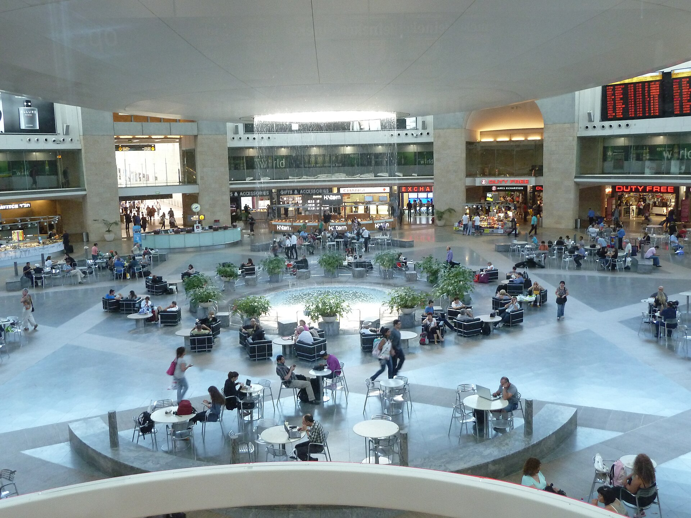

מחירי הטיסות לחו"ל, שזינקו לשיאים חסרי תקדים בשנתיים האחרונות, מתחילים סוף־סוף לרדת. הסיבה המרכזית: חזרתן ההדרגתית של חברות התעופה הזרות לנמל התעופה בן גוריון, לאחר תקופה ארוכה שבה צמצמו או הקפיאו את פעילותן בישראל. התחרות המתחדשת שוברת את המונופול הכמעט מוחלט שנהנתה ממנו אל על, ומחזירה את כוח המיקוח לידי הצרכן הישראלי.

## מדוע מחירי הטיסות לחו"ל קפצו כל כך?

במהלך תקופת המלחמה עזבו עשרות חברות תעופה זרות את השמיים הישראליים, חלקן לחודשים ארוכים. התוצאה הייתה ירידה חדה בהיצע המושבים — בעוד הביקוש של הישראלים לטוס לחו"ל נותר גבוה. כלכלת ההיצע והביקוש הבסיסית עשתה את שלה: המחירים זינקו בעשרות אחוזים, וביעדים מסוימים אף הוכפלו.

אל על, שנותרה כמעט לבדה בשוק, רשמה רווחי שיא. חברת התעופה הלאומית נהנתה מכך שהנוסע הישראלי נותר ללא חלופות ממשיות, בעיקר ביעדים ישירים ובשעות המבוקשות. כרטיס טיסה לאירופה, שעד לא מכבר נמכר במאות שקלים בודדות, הגיע לא פעם לאלפי שקלים.

## מה משתנה עכשיו?

עם התייצבות המצב הביטחוני, חברות התעופה הזרות חוזרות בהדרגה לנתב"ג — ואיתן נפתח מחדש ברז ההיצע. חברות אירופיות גדולות, לואו-קוסט וחברות המזרח הרחוק מחדשות קווים, מגדילות תדירויות ומשיקות מבצעים אגרסיביים כדי לחזור ולהתברג בשוק הישראלי.

ככל שההיצע גדל, הלחץ על המחירים גובר. ביעדים הפופולריים באירופה כבר נרשמות ירידות מחירים, בעיקר בטיסות שאינן בשיא העונה. גם חברות הלואו-קוסט, שהיו גורם מרכזי בהוזלת מחירי הטיסות בעשור הקודם, חוזרות לשחק תפקיד מרכזי.

### איך אל על מגיבה?

ההערכה היא שאל על תיאלץ להתאים את מחיריה כלפי מטה כדי לשמר נתח שוק מול התחרות המתחדשת. עם זאת, החברה צפויה להמשיך ולמצב את עצמה בפרמיה מסוימת — בזכות טיסות ישירות, שירות וביטחון. השאלה המרכזית היא עד כמה מהירה תהיה חזרת החברות הזרות, ובאיזו עוצמה.

## השוואת מחירים: לפני ואחרי חזרת התחרות

הטבלה הבאה מציגה מגמות כלליות במחירי טיסות הלוך-ושוב מישראל, כאומדן להמחשת הכיוון (הנתונים הם הערכות מגמה ולא מחירים מחייבים):

| יעד | שיא תקופת המלחמה (הערכה) | מגמה נוכחית |
|------|--------------------------|--------------|
| יעדים קרובים באירופה | גבוה מאוד | ירידה ניכרת |
| מערב אירופה | גבוה | ירידה מתונה |
| ארצות הברית | גבוה מאוד | יציבות עם נטייה לירידה |
| המזרח הרחוק | גבוה מאוד | ירידה הדרגתית |

המגמה הכללית ברורה: ככל שמספר החברות הפעילות עולה, כך נפתח מרחב להוזלות — במיוחד מחוץ לעונות השיא ולחופשות המרוכזות.

## מה כדאי לנוסע הישראלי לעשות?

- **להשוות מחירים בין חברות** — עם חזרת התחרות, הפערים בין החברות השונות עשויים להיות משמעותיים.
- **לבחון חברות לואו-קוסט** — ליעדים הקרובים, ההוזלה עשויה להיות דרמטית, אך יש לשים לב לעלויות נלוות (מזוודות, בחירת מושב).
- **להזמין מוקדם ליעדים מבוקשים** — בעונות שיא ובחגים ההיצע עדיין מוגבל, והמחירים נותרים גבוהים.
- **לעקוב אחר מבצעי חזרה** — חברות שחוזרות לשוק משיקות לא פעם מחירי השקה אטרקטיביים כדי לבנות מחדש את בסיס הלקוחות.

## שורה תחתונה

מחירי הטיסות לחו"ל נמצאים בנקודת מפנה. אחרי תקופה ארוכה שבה שילם הנוסע הישראלי פרמיה כבדה בשל מחסור בתחרות, חזרת חברות התעופה הזרות מחזירה את האיזון לשוק. הירידה לא תהיה אחידה ולא מיידית — אך הכיוון הכללי מיטיב עם הצרכן. למי שמתכנן חופשה, כדאי לעקוב מקרוב אחר ההיצע המתרחב ולנצל את חלון ההזדמנויות.
