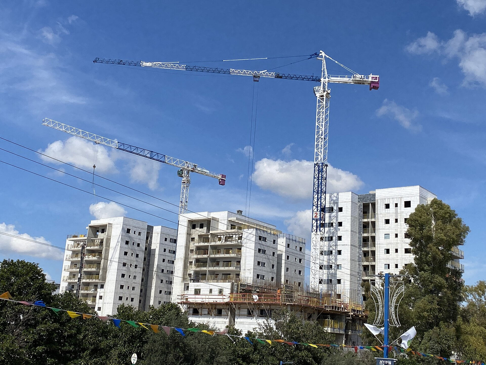

**שכר הדירה בישראל ממשיך לטפס** גם ברבעונים שבהם שוק המכירות נבלם כמעט לחלוטין. בעוד עסקאות הרכישה סובלות מריבית גבוהה ומחוסר ודאות, מחירי השכירות דווקא ניצבים בחזית ההתייקרות — ומכבידים במיוחד על זוגות צעירים, סטודנטים ומשפחות באזורי הביקוש. מדובר באחד הסעיפים הבולטים בעליית מדד המחירים לצרכן, ובמוקד דאגה מתמשך בבנק ישראל ובלשכה המרכזית לסטטיסטיקה.

ההסבר המרכזי לעליית שכר הדירה הוא פשוט: כשרוכשים רבים נדחקים החוצה משוק הקנייה בגלל ריבית המשכנתא הגבוהה, הם נותרים שוכרים — והביקוש לשכירות עולה מול היצע שאינו גדל באותו קצב.

## מדוע שכר הדירה ממשיך לעלות?

כמה כוחות פועלים בו-זמנית על שוק השכירות:

- **ריבית גבוהה בולמת רכישות.** משקי בית שתכננו לקנות דירה דוחים את המהלך, נשארים בשכירות ומגדילים את הביקוש.
- **מחסור בהיצע.** האטה בהתחלות הבנייה, עיכובים בפרויקטים ומחסור בעובדים בענף מצמצמים את זרם הדירות החדשות המגיעות לשוק.
- **הגירה פנימית לאזורי תעסוקה.** הביקוש למגורים סביב מרכזי התעסוקה בגוש דן, בחיפה ובבאר שבע נותר חזק.
- **אינפלציה ועוגן ההצמדה.** חוזי שכירות רבים צמודים למדד, כך שעליית המחירים הכללית מתגלגלת ישירות לשכר הדירה.

התוצאה: גם כשמחירי המכירה של דירות מראים סימני התמתנות או קיפאון, רכיב השכירות ממשיך להיות גורם אינפלציוני עקשן.

## כמה באמת מכביד שכר הדירה על הכיס?

עבור משקי בית צעירים רבים במרכז הארץ, שכר הדירה מגיע לנתח של כ-30% ואף 40% מההכנסה הפנויה. זהו נטל גבוה בהשוואה למקובל, ומצמצם את יכולת החיסכון — בין היתר את היכולת לצבור הון עצמי לרכישת דירה, מה שמנציח את מעגל השכירות.

### השכירות מול המשכנתא

בעבר רווחה הטענה ש"החזר משכנתא זול משכר דירה". עליית הריבית שינתה את המשוואה: ההחזר החודשי על משכנתה חדשה טיפס משמעותית, ולעיתים כבר אינו זול משמעותית מתשלום שכירות על נכס דומה — אך דורש הון עצמי התחלתי גבוה שרבים מתקשים לגייס.

## טבלת השוואה: שכירות מול רכישה בסביבת ריבית גבוהה

| פרמטר | שכירות | רכישה (עם משכנתא) |
|---|---|---|
| הון עצמי התחלתי | נמוך (בדרך כלל פיקדון) | גבוה (לרוב 25% ומעלה ממחיר הדירה) |
| חשיפה לריבית | עקיפה, דרך הצמדה למדד | ישירה ומשמעותית בהחזר החודשי |
| גמישות מעבר | גבוהה | נמוכה |
| צבירת הון עצמי | אין | יש, לאורך זמן |
| ודאות עלויות | נמוכה (תלוי בחידוש חוזה) | גבוהה יחסית במסלולים קבועים |

## מה אומרים בבנק ישראל ובמשרד השיכון?

בבנק ישראל מצביעים זה זמן על מרכיב הדיור כאחד הגורמים המרכזיים שמקשים על ריסון האינפלציה. ככל שהריבית תרד בהדרגה, ייתכן שחלק מהשוכרים יחזרו לשוק הרכישה — מהלך שעשוי להקל מעט על לחצי הביקוש בשכירות.

במקביל, המדינה מנסה לקדם את שוק **השכירות המוסדית ארוכת-הטווח**, שבו גופים מוסדיים מקימים ומנהלים בנייני מגורים שלמים להשכרה בתנאים יציבים יותר. היקף הפרויקטים האלה עדיין קטן ביחס לגודל השוק, אך הוא נתפס ככלי מרכזי להגדלת ההיצע ולייצוב מחירי השכירות בטווח הארוך.

## מה צפוי בשוק השכירות בשנה הקרובה?

התחזיות זהירות. כל עוד היצע הדירות החדשות נותר מוגבל והריבית אינה יורדת בחדות, קשה לראות היפוך מגמה מהיר בשכר הדירה. התרחיש הסביר יותר הוא המשך עליות מתונות, עם שונוּת גבוהה בין אזורי ביקוש לפריפריה.

לשוכרים מומלץ לבחון מראש את מנגנון ההצמדה בחוזה, לנסות לקבע את שכר הדירה לתקופה ארוכה יותר כשניתן, ולהשוות בין אזורים — שכן הפער בין שכונות ובין ערים יכול להגיע למאות שקלים בחודש על נכס דומה.

השורה התחתונה: שכר הדירה הפך לאחד הסמנים הברורים של משבר הדיור בישראל, והוא ימשיך להשפיע על תקציב משקי הבית — ועל מדד המחירים לצרכן — גם בחודשים הקרובים.
