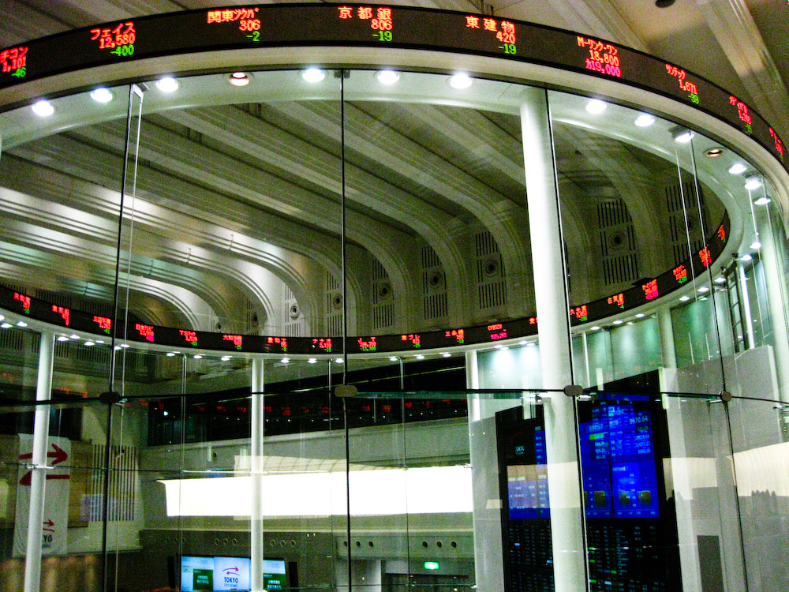

מדד **ת"א 35**, המדד המוביל של הבורסה בתל אביב, נסחר בחודשים האחרונים סמוך לשיאים היסטוריים, לאחר שנה של עליות חדות שהפכו את השוק הישראלי לאחד המתפקדים טוב בעולם. התשובה הקצרה לשאלה אם מאוחר מדי להיכנס: לא בהכרח — אך מי שנכנס עכשיו עושה זאת ברמות מחיר גבוהות משמעותית מאלו ששררו לפני שנה, ולכן נדרש לפזר, לגוון ולהיכנס בהדרגה ולא בבת אחת.

## מה מניע את מדד ת"א 35 לשיאים?

מספר כוחות פועלים יחד. ראשית, **הירידה בפרמיית הסיכון** של ישראל לאחר תקופה ממושכת של מתח גאו-פוליטי. ככל שתחושת היציבות משתפרת, המשקיעים הזרים והמקומיים מוכנים לשלם יותר עבור נכסים ישראליים. שנית, **מניות הבנקים** — לאומי, הפועלים, מזרחי טפחות ודיסקונט — שמרכיבות נתח מכריע מהמדד, רשמו רווחי שיא על רקע סביבת הריבית הגבוהה, והמשיכו לחלק דיבידנדים נדיבים ולבצע רכישות עצמיות של מניות.

גורם שלישי הוא **חזרת ההון הזר**. לאחר תקופה של יציאת כספים, נרשמת מגמה הפוכה של כניסת משקיעים מוסדיים זרים, שמחפשים חשיפה לשוק שנסחר במכפילים אטרקטיביים יחסית.

## האם השוק יקר מדי?

כאן התמונה מורכבת. למרות השיאים, **מכפילי הרווח** של הבנקים הישראליים עדיין נחשבים נמוכים בהשוואה לבנקים אמריקאיים ואירופיים, מה שמותיר מקום לטיעון שהשוק עדיין אינו "מנופח". מנגד, חלק מהמשקיעים חוששים שסביבת הריבית הגבוהה — שהיתה מנוע הרווחים של הבנקים — תתחיל להתמתן ככל שבנק ישראל יוריד את הריבית, מה שעלול ללחוץ על הרווחיות קדימה.

חשוב לזכור שמדד ת"א 35 הוא **מרוכז מאוד**: הבנקים והביטוח מהווים חלק ניכר ממנו, כך שתנודה בסקטור הפיננסי משפיעה באופן דרמטי על כלל המדד. זהו יתרון בתקופת גאות — וסיכון בתקופת ירידות.

## השוואת אפיקים: היכן עומד השוק הישראלי?

| אפיק השקעה | מאפיין מרכזי | רמת סיכון |
|---|---|---|
| מדד ת"א 35 | ריכוז גבוה בבנקים וביטוח, מכפילים נמוכים יחסית | בינונית-גבוהה |
| מדד ת"א 125 | פיזור רחב יותר, כולל נדל"ן וטכנולוגיה | בינונית |
| נאסד"ק | חשיפה לטכנולוגיה גלובלית ולבינה מלאכותית | גבוהה |
| אג"ח ממשלתי | תשואה יציבה, רגישות לריבית | נמוכה |

## מה כדאי למשקיע הישראלי לעשות?

מומחים רבים ממליצים שלא לנסות **לתזמן את השוק** ברמות שיא. במקום זאת, הגישה הנפוצה היא כניסה הדרגתית (פריסת השקעה לאורך זמן), שמפחיתה את הסיכון של כניסה בדיוק ערב תיקון.

### כמה עקרונות מעשיים

- **פיזור בין מדדים**: מי שרוצה חשיפה רחבה יותר יכול לשקול את מדד ת"א 125 במקום ת"א 35 בלבד, לצמצום הריכוזיות בסקטור הפיננסי.
- **פיזור גלובלי**: שילוב בין הבורסה בתל אביב למדדים בינלאומיים כמו נאסד"ק ו-S&P 500 מקטין את התלות בכלכלה המקומית.
- **אופק זמן ארוך**: השקעה במניות מתאימה לכספים שאינם נדרשים בטווח הקצר.
- **תשומת לב לעלויות**: דמי ניהול וניהול תיקים אוכלים מהתשואה לאורך שנים.

## הסיכונים שצריך לזכור

גם בתרחיש אופטימי, השיאים אינם מבטיחים המשך עליות. **הסלמה גאו-פוליטית**, האטה בצמיחה הגלובלית, או ירידת ריבית חדה שתפגע ברווחי הבנקים — כל אלה עלולים להפוך את המגמה. מי שנכנס לשוק ברמות הנוכחיות צריך להיות מוכן נפשית גם לתנודתיות ולירידות זמניות, ולא למכור בבהלה בכל טלטלה.

בשורה התחתונה: מדד ת"א 35 בשיא משקף אמון מחודש בכלכלה הישראלית ובמערכת הבנקאית, אך רמות המחיר הגבוהות מחייבות משמעת, פיזור וסבלנות — ולא רדיפה אחרי תשואות העבר.
