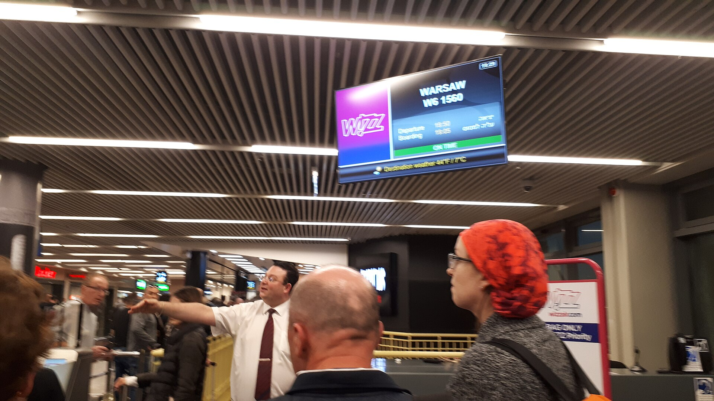

מחירי הטיסות מישראל נותרו גבוהים באופן חריג גם לאחר שחברות התעופה הזרות החלו לשוב לנמל התעופה בן גוריון. התשובה הקצרה לשאלה מדוע כרטיס לחו"ל עדיין יקר: שילוב של תחרות דלה בחלק מהקווים, עלויות ביטחון וביטוח גבוהות, וביקוש כבוש שחזר במלוא העוצמה אל מול היצע מושבים מוגבל. התוצאה היא שהצרכן הישראלי משלם פרמיה ניכרת ביחס לנוסע האירופי הממוצע.

## למה מחירי הטיסות מישראל עדיין גבוהים?

בשיא תקופת ההפרעות לתעופה עזבו רוב חברות התעופה הזרות את ישראל, ואל על וחברות ישראליות נוספות נותרו כמעט לבדן בחלק מהיעדים המבוקשים. גם כעת, כשהחברות הזרות חוזרות בהדרגה, החזרה אינה מלאה: תדירות הטיסות בחלק מהקווים נמוכה מזו שהייתה, וחברות הלואו-קוסט האירופיות מהססות להחזיר את מלוא הקיבולת.

כל עוד מספר המושבים המוצעים נמוך מהביקוש, מנגנון התמחור הדינמי של חברות התעופה דוחף את המחירים כלפי מעלה. מחיר הכרטיס אינו קבוע — הוא נקבע לפי מידת התפיסה של המטוס, וכשהמטוסים מתמלאים מהר, מעט המושבים האחרונים נמכרים במחירים מופקעים.

### העלויות הנסתרות בכרטיס

מעבר לתחרות, על מחיר הכרטיס מישראל מתווספים רכיבים ייחודיים:

- **פרמיות ביטוח וסיכון** גבוהות יותר לחברות המפעילות קווים לישראל.
- **עלויות ביטחון** הנגבות בנמל התעופה ומגולגלות אל הנוסע.
- **מחירי דלק סילוני** תנודתיים, המשפיעים על כלל ענף התעופה העולמי.
- **היטלים ואגרות** נמל התעופה, המהווים נתח קבוע מהמחיר הסופי.

## כמה באמת עולה לטוס מישראל?

הטבלה שלהלן מציגה הערכת מגמה כללית של פערי המחירים בין יעדים נפוצים, ביחס לרמות שלפני המשבר. מדובר בהערכות טווח ולא במחירים מדויקים, שכן המחיר משתנה לפי עונה ומועד ההזמנה.

| יעד | מגמת מחיר כיום | רמת התחרות |
|------|----------------|-------------|
| יעדים קצרים באירופה | גבוה מהממוצע האירופי | בינונית |
| ערי בירה מרכזיות | התייצבות הדרגתית | משתפרת |
| יעדים רחוקים (ארה"ב, המזרח הרחוק) | גבוה משמעותית | נמוכה |
| יעדי נופש עונתיים | תנודתי מאוד | משתנה |

הפער הבולט ביותר נרשם בטיסות הארוכות, שבהן מספר החברות המתחרות קטן, ולכן היכולת של הנוסע הישראלי להשוות מחירים מוגבלת.

## מתי צפויה הקלה במחירים?

הכיוון חיובי אך הדרגתי. ככל שחברות תעופה זרות נוספות יחזירו את מלוא הקווים והתדירויות, ובמיוחד חברות הלואו-קוסט, הלחץ התחרותי צפוי למתן את המחירים. ההיסטוריה של ענף התעופה מלמדת שהוספת מתחרה אחד משמעותי בקו נתון עשויה להוריד את המחיר הממוצע באופן ניכר תוך חודשים ספורים.

עם זאת, כל עוד הביקוש הכבוש נותר גבוה והישראלים ממשיכים לנסוע בהיקפים שיא, חברות התעופה נהנות מכוח תמחור חזק. גם רכיבי העלות הקבועים — ביטחון, ביטוח ואגרות — אינם צפויים לרדת בטווח הקרוב.

## איך לחסוך בכרטיס הטיסה הבא?

גם בסביבת מחירים גבוהה, יש כלים מעשיים לצמצום ההוצאה:

1. **הזמינו מראש** — חלון של חודשיים עד ארבעה חודשים לפני הטיסה נוטה להציע את המחירים הטובים ביותר ליעדים מבוקשים.
2. **היו גמישים בתאריכים** — הבדל של יום-יומיים בטיסה עשוי לחסוך מאות שקלים.
3. **שקלו עצירת ביניים** — טיסות עם קונקשן דרך צומת אירופי לרוב זולות מטיסה ישירה.
4. **השוו בין מנועי חיפוש** — מחירים שונים מופיעים בפלטפורמות שונות, ולעיתים ההזמנה הישירה באתר החברה משתלמת יותר.
5. **עקבו אחר חזרת חברות חדשות** — כניסת מתחרה לקו שלכם היא הזדמנות למחירים אטרקטיביים בתקופת ההשקה.

השורה התחתונה: מחירי הטיסות מישראל צפויים להישאר גבוהים יחסית בטווח הקצר, אך כיוון השוק הוא של נורמליזציה הדרגתית. הצרכן המודע, שמזמין מראש ומשווה בין חלופות, יכול להמשיך ולחסוך גם בסביבה מאתגרת זו.
