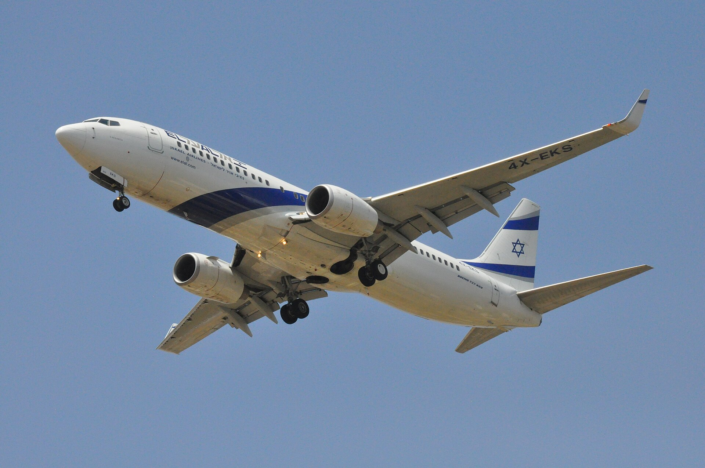

מחירי הטיסות לחו"ל ממשיכים להכביד על כיסם של הישראלים: למרות חזרה הדרגתית של חברות התעופה הזרות לנמל התעופה בן-גוריון, מחיר הכרטיס הממוצע ליעדים מבוקשים באירופה נותר גבוה בעשרות אחוזים ביחס לרמות שהכרנו לפני כמה שנים. הסיבה המרכזית פשוטה: הביקוש התאושש מהר יותר מההיצע, והתחרות בשמי ישראל עדיין רחוקה מלחזור לעוצמתה.

## מדוע מחירי הטיסות לחו"ל נותרו גבוהים?

בשיא התחרות, עשרות חברות תעופה זרות — ביניהן ענקיות שוק כמו לופטהנזה, איזיג'ט וויזאייר — התחרו על הנוסע הישראלי והורידו את המחירים לרמות שיא נמוכות. בשנים האחרונות, על רקע אי-הוודאות הביטחונית, חלק מהחברות צמצמו טיסות או השעו אותן לחלוטין. התוצאה: פחות מושבים זמינים, פחות תחרות, ומחיר כרטיס שמזנק בעיקר בעונות השיא ובסופי שבוע.

חברות ישראליות — ובראשן אל על, ישראייר וארקיע — נהנו מהיעדר התחרות והגדילו נתחי שוק, אך גם הן מתמודדות עם עלויות תפעול מאמירות. כאשר ההיצע מוגבל והביקוש לחופשה בחו"ל אינו דועך, המחיר נקבע כמעט כולו לטובת המוכר.

## מה מרכיב את מחיר הכרטיס?

מחיר הטיסה אינו מורכב רק מ"מחיר המושב". שורה של גורמים מתגלגלת אל הצרכן:

- **מחירי הדלק הסילוני** — מרכיב משמעותי בעלות, הנגזר ממחירי הנפט הגולמי ומשער הדולר-שקל.
- **פרמיות ביטוח ועלויות אבטחה** — שעלו באזורנו בשנים האחרונות.
- **חידוש והחכרה של מטוסים** — צי מטוסים מודרני יקר לתחזוקה ולמימון בסביבת ריבית גבוהה.
- **היטלים ואגרות** בנמלי התעופה בארץ וביעד.
- **מרווח הרווח** של חברת התעופה, שגדל כאשר התחרות נמוכה.

## השוואת מחירים: כך השתנה הכרטיס הממוצע

הטבלה הבאה ממחישה את כיוון המגמה ביעדים מרכזיים (הערכות טווח, לכרטיס הלוך-ושוב בעונה רגילה):

| יעד | טווח מחיר לפני המשבר | טווח מחיר נוכחי (הערכה) | כיוון המגמה |
|------|----------------------|--------------------------|--------------|
| אתונה / לרנקה | נמוך מאוד | בינוני | עלייה מתונה |
| רומא / מילאנו | נמוך-בינוני | בינוני-גבוה | עלייה ניכרת |
| לונדון / פריז | בינוני | גבוה | עלייה ניכרת |
| ניו יורק | גבוה | גבוה מאוד | עלייה חדה |

המגמה ברורה: ככל שהיעד רחוק יותר והתלות בחברות הזרות גבוהה יותר, כך הייקור מורגש יותר. ליעדים קרובים, שבהם ישנה עדיין תחרות ערה, הפער מתון יחסית.

## מתי צפויה הוזלה במחירי הטיסות?

ההוזלה תלויה בעיקר במשתנה אחד: חזרה מלאה של חברות התעופה הזרות. ככל שהיציבות הביטחונית תתבסס, צפויות חברות נוספות לחדש את קווי הטיסה לישראל ולהגדיל את התדירות. הגדלת ההיצע היא הכוח המשמעותי ביותר שיכול להוריד מחירים — הרבה יותר מכל רגולציה או מבצע נקודתי.

בנוסף, רשות התעופה האזרחית ומשרד התחבורה פועלים לעודד תחרות ולהסיר חסמים. אך כל עוד הביקוש הישראלי לחופשות נותר חזק, סביר שהמחירים ירדו בהדרגה בלבד.

## כיצד לחסוך במחיר הכרטיס?

גם בסביבת מחירים גבוהה, יש מרחב לחיסכון של מאות שקלים לכרטיס:

1. **הזמינו מוקדם** — מחירי טיסות בעונת השיא מזנקים ככל שמתקרבים לתאריך.
2. **היו גמישים בתאריכים** — טיסה באמצע השבוע זולה בדרך כלל מסוף שבוע.
3. **השוו בין מנועי חיפוש** ובדקו ישירות באתרי חברות התעופה.
4. **שקלו יעד חלופי** — לעיתים טיסה ליעד סמוך זולה בעשרות אחוזים.
5. **הפרידו כרטיסים** — טיסה עם חיבור או שילוב חברות עשויה להוזיל את העלות.
6. **עקבו אחר מבצעים** של חברות הלואו-קוסט שחוזרות לשוק.

## שורה תחתונה

מחירי הטיסות לחו"ל משקפים בראש ובראשונה חוסר איזון בין היצע מצומצם לביקוש איתן. עד שהתחרות בשמי ישראל תחזור למלוא עוצמתה, הצרכן הישראלי ימשיך לשלם פרמיה על החופשה. התכנון המוקדם, הגמישות והשוואת המחירים הם הכלים האפקטיביים ביותר להקטין את הפגיעה בכיס.
