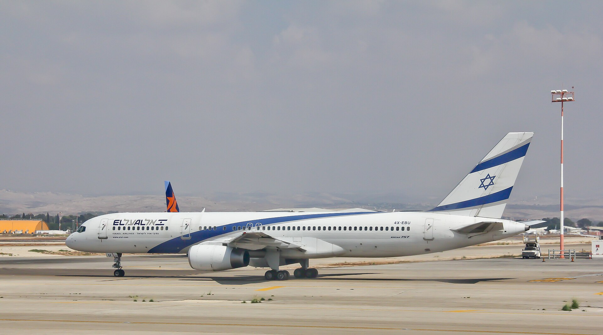

מחירי הטיסות מישראל, שזינקו בחדות מאז פרוץ המלחמה באוקטובר 2023, מתחילים סוף־סוף להראות סימני התמתנות — אך הם עדיין רחוקים מהרמות שהכיר הצרכן הישראלי לפני המשבר. הגורם המרכזי לשינוי הוא חזרתן ההדרגתית של חברות התעופה הזרות לנמל התעופה בן־גוריון, מהלך שמגביר את התחרות ומתחיל ללחוץ את המחירים כלפי מטה. עם זאת, מי שמתכנן חופשה בחו"ל צריך עדיין לתכנן בקפידה כדי למצוא עסקה משתלמת.

## למה מחירי הטיסות זינקו כל כך?

בשיא המשבר, כאשר עשרות חברות זרות השעו את פעילותן לישראל, נותרו הנוסעים הישראלים כמעט ללא חלופות. אל על, ובמידה פחותה ישראייר וארקיע, נהנו ממעין מונופול זמני על היעדים המבוקשים. התוצאה הייתה קפיצה של עשרות ואף מאות אחוזים במחירי כרטיסי הטיסה ליעדים פופולריים כמו ניו יורק, בנגקוק ובירות אירופה.

עבור אל על, התקופה הזו הייתה גן עדן עסקי. החברה דיווחה על רווחי שיא, ומחיר המניה שלה בבורסה בתל אביב זינק בעשרות אחוזים, לאחר שנים של קשיים. הביקוש הכבוש, בשילוב היצע מצומצם, יצר תנאי שוק אידיאליים למי שהמשיך להפעיל מסלולים.

## מה השתנה עכשיו?

עם התייצבות המצב הביטחוני, חברות התעופה הזרות שבות בהדרגה לישראל. ענקיות כמו לופטהנזה, איזיג'ט, וויזאייר ואייר פראנס חידשו או מרחיבות את פעילותן, והתחרות על כיסו של הנוסע הישראלי מתחדשת. ככל שההיצע גדל, הלחץ על אל על לרסן את המחירים מתעצם.

עדיין מדובר בתהליך הדרגתי. חלק מהחברות חזרו בתדירות נמוכה מבעבר, וביטוחי התעופה והעלויות התפעוליות ליעד הישראלי נותרו גבוהים. לכן, גם אם המגמה ברורה, הירידה במחירים אינה אחידה בין היעדים ובין עונות השנה.

### השוואת מחירים: אז והיום

הטבלה הבאה ממחישה את סדר הגודל של התנודות במחירי טיסה הלוך־ושוב ממוצעים (הערכות, בדולרים), ליעדים נבחרים:

| יעד | לפני אוקטובר 2023 | שיא המשבר | מגמה נוכחית |
|------|------------------|-----------|--------------|
| בירות אירופה | כ-150-250 | כ-350-500 | בירידה הדרגתית |
| ניו יורק | כ-700-900 | כ-1,300-1,800 | מתייצב כלפי מטה |
| בנגקוק | כ-600-800 | כ-1,100-1,500 | עדיין גבוה |

*הנתונים הם הערכות מגמה בלבד ומשתנים לפי מועד ההזמנה והעונה.*

## האם כדאי להמתין להוזלות נוספות?

השאלה המרכזית שמעסיקה את הצרכנים היא האם להזמין עכשיו או להמתין. התשובה תלויה בעיקר במועד הנסיעה ובגמישות. ליעדים אירופיים, שבהם התחרות כבר חזרה בעוצמה, סביר שהמחירים ימשיכו להתמתן לקראת עונת הקיץ. לעומת זאת, בטיסות ארוכות־טווח ובתקופות שיא כמו חגים וחופשות — הביקוש הגבוה עשוי לשמר מחירים גבוהים גם אם ההיצע יגדל.

## כיצד מוצאים כרטיס טיסה משתלם?

גם בשוק מתייקר, קיימים כלים שמאפשרים לצרכן הישראלי לחסוך מאות ואף אלפי שקלים:

- **הזמנה מוקדמת:** ככלל, הזמנה של 6-10 שבועות מראש ליעדים אירופיים ו-3-5 חודשים ליעדים רחוקים נוטה להניב מחירים נמוכים יותר.
- **גמישות בתאריכים:** טיסה באמצע השבוע או מחוץ לעונת השיא יכולה לחסוך עשרות אחוזים.
- **אתרי השוואה:** שימוש במנועי חיפוש כמו גוגל פלײטס, סקайסקאנר וקאיאק מאפשר לזהות את החברות הזולות ואת מועדי הטיסה האופטימליים.
- **טיסות עם עצירת ביניים:** ויתור על טיסה ישירה לטובת חיבור דרך יעד אירופי מרכזי עשוי להוזיל משמעותית את הכרטיס.
- **מעקב אחר מבצעים:** חברות הלואו־קוסט ואל על עצמה משיקות מבצעים נקודתיים, שמתגמלים את מי שעוקב ומזמין במהירות.

## מה צפוי בהמשך?

הכיוון הכללי בשוק התעופה הישראלי הוא של התחזקות התחרות וירידה הדרגתית במחירים, ככל שהיציבות הביטחונית תימשך ויותר חברות יחזרו במלוא העוצמה. עבור אל על, המשמעות היא שחיקה בשולי הרווח יוצאי הדופן של השנתיים האחרונות — אך עבור הצרכן הישראלי, מדובר בבשורה חיובית. מי שיתכנן נכון, יהיה גמיש וישווה מחירים, ייהנה כבר כעת מהתחרות המתחדשת בשמי ישראל.
