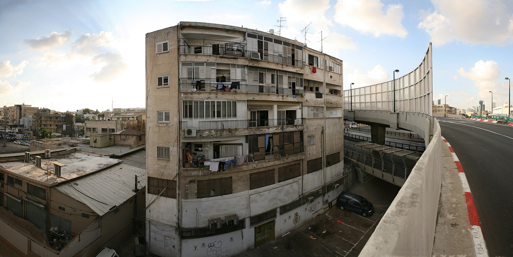

שוק הנדל"ן הישראלי נמצא בנקודת מפנה: **מלאי הדירות הלא מכורות** נושק לשיא היסטורי של עשרות אלפי יחידות דיור חדשות שטרם מצאו קונה, בעוד חברות הבנייה נאנקות תחת נטל הריבית הגבוהה ועלויות מימון מזנקות. התוצאה היא מאזן כוחות מתהפך — לראשונה זה שנים, היד של הרוכשים עשויה להיות על העליונה.

הצטברות המלאי אינה נובעת מעצירת הבנייה אלא מההפך: היצע גדול של פרויקטים שהחלו בשנים הקודמות מגיע כעת לשוק, בדיוק כשהביקושים מתקררים. הריבית הגבוהה ייקרה את המשכנתאות, הרתיעה משקיעים והקפיאה חלק ניכר מהעסקאות. כך נוצר פער גדל בין ההיצע לביקוש.

## מדוע מצטבר מלאי הדירות הלא מכורות?

שורשי התופעה כלכליים במובהק. סביבת הריבית הגבוהה שקבע בנק ישראל במאבקו באינפלציה הפכה את המשכנתה ליקרה משמעותית מבעבר. משק בית ממוצע מגלה שההחזר החודשי על אותה דירה גדל במאות ואף אלפי שקלים לעומת תקופת הריבית האפסית.

במקביל, המשקיעים — שהיו מנוע ביקוש מרכזי — נטשו את השוק. מס רכישה גבוה, תשואות שכירות שנשחקו מול אלטרנטיבות סולידיות, ואי-ודאות כלכלית הרחיקו אותם. גם הזוגות הצעירים, חלקם, בוחרים להמתין ולבחון אם המחירים אכן יירדו.

### הלחץ על חברות הבנייה

עבור הקבלנים, מלאי שאינו נמכר הוא נטל כבד. פרויקט בנוי ממומן ברובו באשראי בנקאי, וכל חודש שבו הדירות עומדות ריקות פירושו תשלומי ריבית נמשכים ללא הכנסה מקבילה. חברות ממונפות במיוחד נכנסות ללחץ תזרימי, וחלקן נאלצות להציע תנאים אטרקטיביים כדי להזרים מזומנים.

## איך מגיבים הקבלנים? מבצעי המימון חוזרים

כדי להניע את השוק, חברות הבנייה חזרו למבצעי מימון אגרסיביים. הבולט שבהם הוא מתווה **20-80**: הרוכש משלם כ-20% מהמחיר בחתימה, והיתרה משולמת רק במסירת המפתח — לעיתים שנתיים-שלוש קדימה. בפועל מדובר בדחיית תשלומים שמפחיתה את הנטל המיידי על הרוכש.

בנק ישראל, יש לציין, מהדק את הפיקוח על מבצעים מסוג זה בשל החשש שהם מסתירים את המחיר האמיתי ומגדילים סיכונים. בנוסף מציעים הקבלנים קיבוע ריבית, הטבות בעיצוב הדירה, ופטור מהצמדה — כל אלה סימנים ברורים לשוק שבו המוכר נלחם על הקונה.

| פרמטר | תקופת הריבית הנמוכה | התקופה הנוכחית |
|---|---|---|
| כוח המיקוח | בידי הקבלן | עובר לרוכש |
| מבצעי מימון | מועטים | נפוצים (20-80) |
| קצב העסקאות | גבוה | מואט |
| מלאי לא מכור | נמוך-בינוני | סביב שיא |
| כיוון המחירים | עולה בחדות | יציב עד יורד מעט |

## האם מחירי הדירות סוף סוף יירדו?

כאן טמון הפרדוקס של השוק הישראלי. למרות הצטברות המלאי וההאטה בעסקאות, מחירי הדירות מגלים עקשנות יוצאת דופן כלפי מטה. הקבלנים מעדיפים להמתין, להציע הטבות מימון ולדחות תשלומים — ובלבד שלא לחתוך את מחיר המחירון הנקוב, מהלך שעלול לפגוע בשווי הבטוחות מול הבנקים ובפרויקטים עתידיים.

עם זאת, ההיסטוריה הכלכלית מלמדת שלא ניתן להחזיק מלאי גדול לאורך זמן בלי לשלם מחיר. אם הריבית תיוותר גבוהה והביקושים לא יתאוששו, ייתכן שנראה ירידות מחירים אמיתיות — תחילה בפריפריה ובאזורי ביקוש משני, ורק בהמשך במרכז.

## מה המשמעות לרוכשים ולמשקיעים?

עבור רוכש דירה למגורים, התקופה הנוכחית מציעה חלון הזדמנות. מאזן הכוחות המתהפך מאפשר מיקוח אמיתי, בחירה מתוך היצע רחב, וניצול מבצעי מימון. עם זאת, חשוב לקרוא את האותיות הקטנות: מבצע 20-80 נוח בטווח המיידי, אך היתרה תמומן בסופו של דבר במשכנתה — ככל הנראה בריבית הגבוהה שתשרור בעת המסירה.

למשקיעים, התמונה מורכבת יותר. תשואות השכירות עדיין נשחקות מול אפיקים סולידיים, והכניסה לשוק בשלב זה דורשת סבלנות ואופק ארוך. מנגד, מי שמזהה פרויקט במצוקה תזרימית עשוי למצוא עסקה אטרקטיבית.

השורה התחתונה: שוק הנדל"ן הישראלי נכנס לשלב של התפכחות. **מלאי הדירות הלא מכורות** הוא הסימן הברור ביותר לכך שעידן העליות הבלתי פוסקות התמתן, לפחות זמנית. הרוכשים הסבלניים — אלה שעושים שיעורי בית, משווים ומתמקחים — הם שעשויים לצאת נשכרים.
