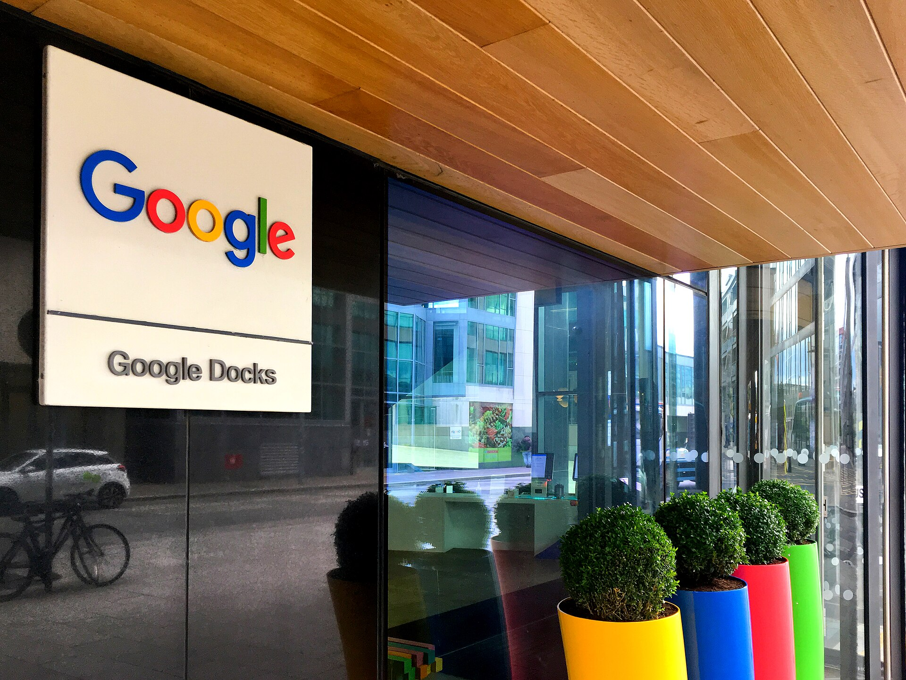

רכישת חברת הסייבר הישראלית **וויז** (Wiz) בידי ענקית הטכנולוגיה **גוגל**, תמורת סכום המוערך בכ-32 מיליארד דולר, היא העסקה הגדולה אי פעם בתולדות ההיי-טק הישראלי. **עסקת וויז-גוגל** אינה רק אקזיט שובר שיאים — היא עדות למעמדו של הסייבר הכחול-לבן כזירה המובילה בעולם, ולהתבגרותו של האקוסיסטם הישראלי אל שלב של חברות ענק עצמאיות.

וויז, שהוקמה ב-2020 בידי אסף רפפורט ושותפיו — צוות שמכר קודם לכן את חברת אדאלום למיקרוסופט — הפכה לאחת החברות הצומחות המהירות בהיסטוריה של התחום. בתוך כחמש שנים בלבד חצתה החברה רף הכנסות שנתיות של מאות מיליוני דולרים, והספיקה לדחות בעבר הצעת רכש של גוגל עצמה לטובת המשך צמיחה עצמאית ואף הנפקה אפשרית.

## מה הופך את עסקת וויז-גוגל לכה משמעותית?

הסכום חסר התקדים ממצב את העסקה הרחק מעל אקזיטים היסטוריים אחרים של חברות ישראליות. מעבר למספרים, המהלך מסמן שינוי מגמה: במקום שחברות ישראליות יימכרו בשלב מוקדם, הן גדלות עד לממדים שמאפשרים להן לנהל מו"מ ממעמד של כוח מול ענקיות עולמיות.

עבור גוגל, הרכישה היא מהלך אסטרטגי במלחמת הענן מול אמזון ומיקרוסופט. פלטפורמת אבטחת הענן של וויז, שמזהה ומתעדפת סיכונים בסביבות ענן מורכבות, משתלבת ישירות בחטיבת גוגל קלאוד ומחזקת את ההצעה הביטחונית שלה מול לקוחות ארגוניים.

### מי מרוויח מהעסקה?

- **המייסדים והעובדים:** מאות עובדים ישראלים צפויים לממש אופציות בשווי משמעותי, מה שיזרים הון פרטי חדש לשוק.
- **קרנות ההון סיכון:** משקיעים מוקדמים, ובהם קרנות ישראליות ובינלאומיות, רושמים תשואות גבוהות.
- **האקוסיסטם:** היסטורית, אקזיטים גדולים מולידים גל של מייסדים חדשים ש"מחזרים" את ההון והידע לסטארטאפים הבאים.

## הסייבר הישראלי: למה דווקא כאן?

ישראל ממשיכה להוביל עולמית בתחום אבטחת המידע, עם נתח ניכר מכלל גיוסי ההון הגלובליים בסייבר. השילוב של יחידות טכנולוגיות צבאיות עילית, תרבות יזמית אגרסיבית ונגישות להון סיכון יצר קרקע פורייה לחברות כמו וויז, אבנת (Armis), קלארוטי, סייברארק (CyberArk) וסנטינל וואן.

הסייבר, לצד הבינה המלאכותית, הוא כיום קטר הצמיחה המרכזי של ההיי-טק המקומי — ענף שאחראי לחלק הארי מהיצוא הישראלי.

## טבלה: אקזיטים בולטים בהיי-טק הישראלי

| חברה | רוכשת | שווי מוערך | תחום |
|---|---|---|---|
| וויז | גוגל | כ-32 מיליארד דולר | אבטחת ענן |
| מובילאיי | אינטל | כ-15 מיליארד דולר | רכב אוטונומי |
| מלאנוקס | אנבידיה | כ-7 מיליארד דולר | תקשורת נתונים |
| סייברארק (הנפקה) | בורסת נאסד"ק | שווי שוק רב-מיליארדי | ניהול הרשאות |

*הנתונים מבוססים על הערכות שוק ודיווחים פומביים ומובאים להמחשת סדרי גודל.*

## מה המשמעות למשקיעים ולכלכלה הישראלית?

עסקאות ענק מסוג זה מזרימות מטבע חוץ לישראל, מגדילות את הכנסות המדינה ממס רווחי הון, ומחזקות את מעמד השקל. עם זאת, הן גם מעוררות שאלה מוכרת: האם ישראל "מוכרת" את חברותיה הטובות מוקדם מדי, במקום לגדל ענקיות טכנולוגיה עצמאיות שיונפקו בבורסה וישמרו את מטה החברה — והערך — בארץ.

מבחינת **בורסת תל אביב**, הנפקה של חברה כמו וויז הייתה יכולה להוות אירוע היסטורי. מכירתה לגוגל ממחישה את האתגר של השוק המקומי למשוך ולהחזיק חברות טכנולוגיה גדולות, שמעדיפות לרוב את נאסד"ק או רכישה אסטרטגית.

## שורה תחתונה

עסקת וויז-גוגל היא אבן דרך: היא מוכיחה שישראל מסוגלת לייצר חברות סייבר בקנה מידה עולמי בתוך שנים ספורות. בטווח הקצר מדובר בהזרמת הון אדירה ובחיזוק הביטחון של המשקיעים בהיי-טק המקומי. בטווח הארוך, השאלה המרכזית תישאר האם הגל הבא של היזמים יבחר לבנות חברות ענק עצמאיות — או שימשיך את מסורת האקזיטים הגדולים.
