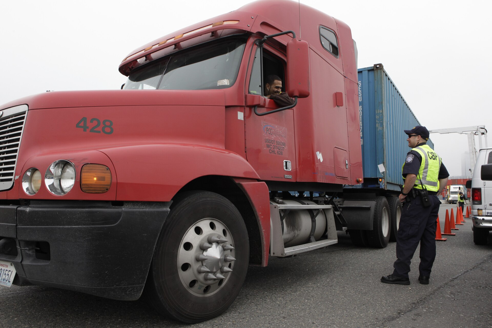

**מכס על קניות מחו"ל** חזר לכותרות ולשולחן הדיונים באוצר, ועלול לשנות את אחת ההרגלים הצרכניים האהובים על הישראלים: ההזמנה הזולה מהאתרים הזרים. כיום נהנה הצרכן הישראלי מפטור נדיב יחסית ברכישות אישיות מחו"ל, אך הלחץ מצד הקמעונאות המקומית והרצון לצמצם את פער המחירים מעוררים מחדש את השאלה — האם עידן החבילה הזולה מעלי אקספרס מתקרב לקצו.

בשורה התחתונה: נכון להיום, רכישה אישית מחו"ל בשווי של עד 75 דולר פטורה ממכס וממע"מ. בטווח שבין 75 ל-500 דולר משולם מע"מ בלבד, ומעל 500 דולר נוסף גם מכס, שגובהו תלוי בסוג המוצר. כל שינוי ברף הזה ייגע ישירות בכיס של מיליוני צרכנים.

## למה הנושא חוזר לסדר היום?

המחלוקת סביב **מכס על קניות מחו"ל** אינה חדשה, אך היא התחדדה עם הזינוק בהיקף ההזמנות מאתרים כמו עלי אקספרס, שיין, אמזון ו-eBay. הקמעונאים הישראלים טוענים כי הפטור יוצר תחרות לא הוגנת: יבואן מקומי משלם מע"מ, מכס ועלויות רגולציה מלאות, בעוד חבילה אישית מסין עוקפת חלק ניכר מהנטל. מנגד, ארגוני הצרכנים מזהירים כי הורדת הסף תתורגם מיד לייקור ישיר של מוצרי צריכה בסיסיים.

עבור משק בית ישראלי ממוצע, המשמעות היא פשוטה: הזמנה של אביזרי אלקטרוניקה, ביגוד או מוצרי בית בעשרות דולרים — שכיום מגיעה ללא תוספת — עלולה לשאת תוספת של מע"מ בשיעור של כ-18%, ובמקרים מסוימים גם דמי טיפול ושחרור.

## כך נראית העלות האמיתית של החבילה

רבים מתמקדים במחיר המוצר באתר, אך מפספסים את התמונה המלאה. העלות הסופית של הזמנה מחו"ל מורכבת ממספר רכיבים, שחלקם נסתרים עד לרגע קבלת החבילה:

- **מחיר המוצר** עצמו, לרוב בדולרים.
- **דמי המשלוch** — שלעיתים מתאפסים במבצע, אך עלולים להכפיל את העלות.
- **מע"מ** — ככל שחל לפי שווי הרכישה.
- **מכס** — על מוצרים מעל סף הפטור הגבוה.
- **דמי טיפול ושחרור** של חברת השילוח או הדואר.

### טבלת השוואה: עלות הזמנה לפי מדרגות

| שווי הרכישה | מע"מ | מכס | הערה לצרכן |
|---|---|---|---|
| עד 75 דולר | פטור | פטור | ההזמנה הכדאית ביותר כיום |
| 75–500 דולר | חל | פטור | תוספת של כ-18% על המחיר |
| מעל 500 דולר | חל | חל (לפי סוג מוצר) | העלות עשויה לקפוץ משמעותית |

הטבלה ממחישה מדוע מרבית ההזמנות הקטנות מתרכזות דווקא מתחת לסף הנמוך — וגם מדוע הורדת הסף תפגע בעיקר ברכישות ה"זולות" שהפכו להרגל צרכני רחב.

## מי יושפע יותר מכולם?

הצרכן שמזמין מוצרים קטנים ותכופים — מכסה לטלפון, כבל טעינה, חולצה או צעצוע — הוא זה שירגיש את ההבדל באופן המיידי ביותר. דווקא ההזמנות היקרות, שעליהן ממילא משולם מע"מ, לא ישתנו באופן דרמטי. לכן כל מהלך של הורדת סף הפטור נתפס כפגיעה ישירה בצרכן בעל ההכנסה הנמוכה והבינונית, שמצא באתרים הזרים מקור לחיסכון משמעותי.

מנגד, תומכי המהלך מצביעים על הפוטנציאל לחיזוק הקמעונאות המקומית, לשמירה על מקומות עבודה ולהגדלת הכנסות המדינה. ההנחה היא שחלק מהכסף שיזרום כיום לאתרים זרים יחזור לשוק הישראלי — אם כי לא מובטח שהדבר יתורגם למחירים נמוכים יותר בחנויות המקומיות.

## מה כדאי לעשות עכשיו?

כל עוד הפטור בתוקפו, מומלץ לצרכן לנהוג בחוכמה: לחשב את העלות הכוללת של ההזמנה — כולל משלוח ותוספות אפשריות — ולא להסתנוור ממחיר המוצר בלבד. כדאי לפצל הזמנות גדולות כשהדבר משתלם, להשוות מול המחיר בשוק המקומי, ולשמור על תיעוד הרכישה למקרה של שחרור במכס.

בשורה התחתונה, **מכס על קניות מחו"ל** ממחיש כיצד החלטה רגולטורית אחת יכולה לגעת ישירות בהרגלי הצריכה של מיליונים. הצרכן המודע, שמכיר את מדרגות המס ואת העלות האמיתית של כל חבילה, יישאר תמיד צעד אחד לפני ההפתעה שבתיבת הדואר.
